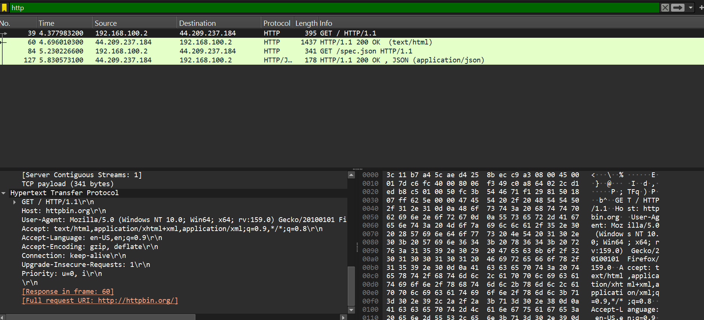
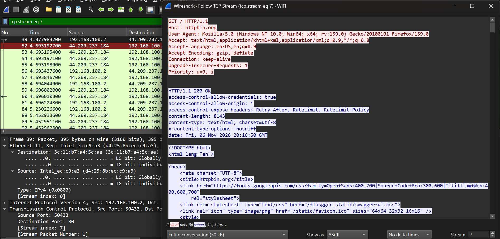
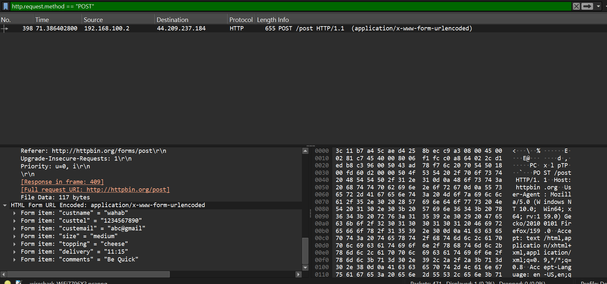
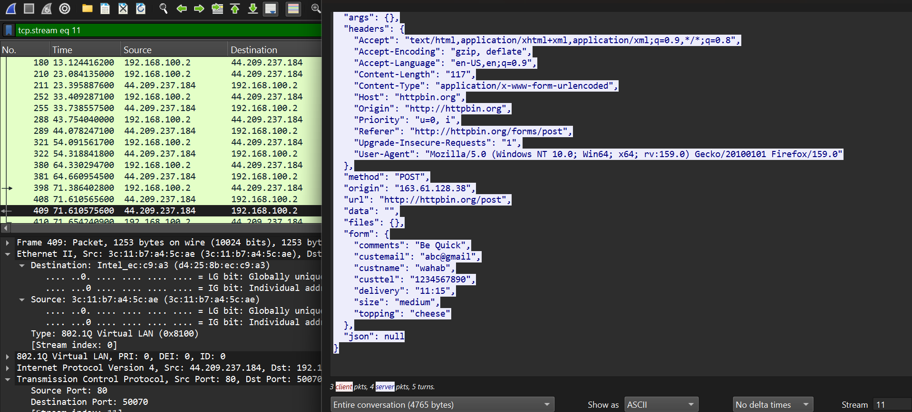

# Lab 01: Analyzing HTTP Traffic with Wireshark

## 📋 Lab Overview
- **Objective:** Capture and dissect unencrypted HTTP communication, analyze GET and POST request/response headers, follow TCP streams, and extract cleartext payload data.
- **Tools Used:** Wireshark v4.x, Web Browser / Sample PCAP
- **Difficulty:** Beginner to Intermediate
- **Status:**  Completed

---

## 🔍 Key Wireshark Display Filters

| Filter Syntax | Purpose / Description |
|---|---|
| `http` | Displays only Hypertext Transfer Protocol packets |
| `http.request.method == "GET"` | Filters for HTTP GET requests |
| `http.request.method == "POST"` | Filters for HTTP POST submissions (form data, logins) |
| `http.response.code == 200` | Filters for successful server responses |
| `tcp.stream eq 0` | Isolates an entire TCP conversation stream |

---

## 🧪 Hands-on Investigation & Walkthrough

### Step 1: Capture Setup & Interface Selection

**Description:**
Select the active network adapter connected to the Internet and begin packet capture before browsing an unencrypted site (e.g., `http://example.com`).

**Wireshark Display Filter:**
```wireshark
http
```

**Evidence / Screenshot:**
<!-- Place your captured screenshot in the screenshots/ directory and link it below -->


**Observed Details:**
- *Source IP / Port:* `192.168.100.2:50433`
- *Destination IP / Port:* `44.209.237.184:80`
- *Protocol / Info:* `HTTP - GET / HTTP/1.1 (Frame 39)`

---
### Step 2: Filtering HTTP Requests

**Description:**
Apply the `http` display filter to eliminate background noise (mDNS, ARP, TLS) and isolate web traffic.

**Wireshark Display Filter:**
```wireshark
http.request.method == "GET"
```

**Evidence / Screenshot:**
<!-- Place your captured screenshot in the screenshots/ directory and link it below -->


**Observed Details:**
- *Source IP / Port:* `192.168.100.2:50433`
- *Destination IP / Port:* `44.209.237.184:80`
- *Protocol / Info:* `HTTP - GET / HTTP/1.1 (Host: httpbin.org)`

---
### Step 3: Dissecting Request Headers

**Description:**
Inspect the Hypertext Transfer Protocol pane to analyze `Host`, `User-Agent`, `Accept-Language`, and query parameters.

**Wireshark Display Filter:**
```wireshark
http.request.method == "POST"
```

**Evidence / Screenshot:**
<!-- Place your captured screenshot in the screenshots/ directory and link it below -->


**Observed Details:**
- *Source IP / Port:* `192.168.100.2`
- *Destination IP / Port:* `44.209.237.184:80`
- *Protocol / Info:* `HTTP - POST /post HTTP/1.1 (HTML Form URL Encoded Payload)`

---
### Step 4: Following TCP Stream & Payload Extraction

**Description:**
Right-click on an HTTP packet and select `Follow > TCP Stream` to observe the bidirectional client-server transaction in plain text.

**Wireshark Display Filter:**
```wireshark
http.response.code == 200
```

**Evidence / Screenshot:**
<!-- Place your captured screenshot in the screenshots/ directory and link it below -->


**Observed Details:**
- *Source IP / Port:* `44.209.237.184:80` (Server Response)
- *Destination IP / Port:* `192.168.100.2` (Client)
- *Protocol / Info:* `HTTP/1.1 200 OK (text/html; charset=utf-8, Length: 8143 bytes)`

---


#### 📊 Summary of Findings & Incident Analysis

| Attribute | Recorded Value | Notes |
|---|---|---|
| **Investigated Target** | `http://httpbin.org` | Unencrypted test web service |
| **Primary Source IP** | `192.168.100.2` | Local Client Machine |
| **Primary Destination IP** | `44.209.237.184` | Target Web Server (httpbin.org) |
| **Tested Request Methods** | `GET` & `POST` | Verified both retrieval and form submission |
| **Stream Index** | `tcp.stream eq 7` | Isolated TCP conversation |
| **Payload Security Status** | Cleartext (Unencrypted) | Credentials/Form data completely exposed in transit |

---

## 🛡️ Security Implications & Key Takeaways

Unencrypted HTTP transmits credentials, session tokens, and data payloads in cleartext across the network, making it vulnerable to sniffing and man-in-the-middle (MitM) eavesdropping.

---

## 🔗 References & Learning Material
- Wireshark User Guide: [wireshark.org/docs/dfref](https://www.wireshark.org/docs/dfref/)
- Reference Lab: [0xrajneesh/Wireshark-Projects-for-beginners](https://github.com/0xrajneesh/Wireshark-Projects-for-beginners)
