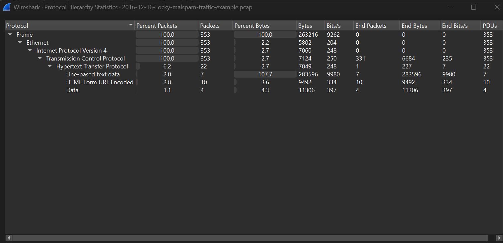
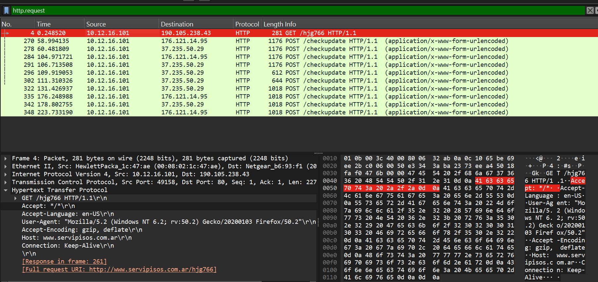
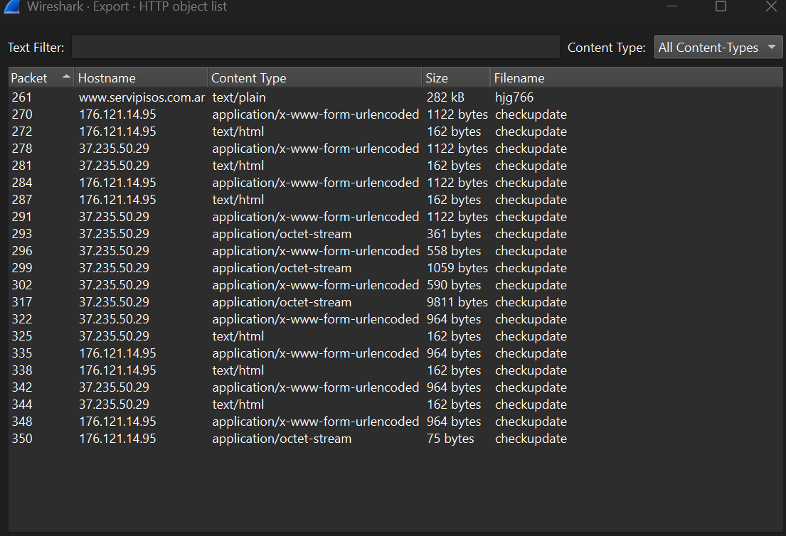
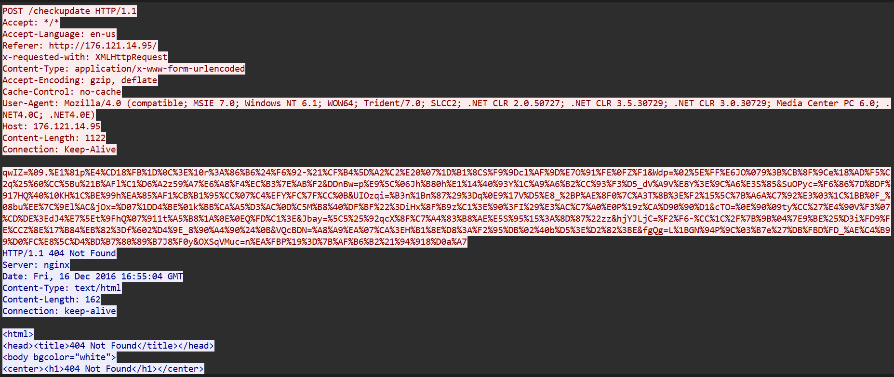

# Lab 02: Detecting & Investigating Malware Traffic

## 📋 Lab Overview
- **Objective:** Investigate a suspicious packet capture to identify malicious host behavior, anomalous DNS queries (C2 domain beaconing), malware delivery payloads, and extract Indicators of Compromise (IoCs).
- **Tools Used:** Wireshark v4.x, Web Browser / Sample PCAP
- **Difficulty:** Beginner to Intermediate
- **Status:** In Progress / Completed

---

## 🔍 Key Wireshark Display Filters

| Filter Syntax | Purpose / Description |
|---|---|
| `dns.flags.response == 0` | Inspects outbound DNS lookup requests made by infected hosts |
| `http.request and !(http.host contains "trusted")` | Isolates suspicious outbound HTTP requests |
| `http.content_type contains "application/octet-stream"` | Finds binary executable downloads over HTTP |
| `ip.addr == <SUSPICIOUS_IP>` | Filters all traffic associated with a flagged Command-and-Control (C2) server |

---

## 🧪 Hands-on Investigation & Walkthrough

### Step 1: Investigating Initial DNS Beaconing

**Description:**
Review DNS queries for high entropy, suspicious top-level domains, or rapid repeated queries indicating Command & Control (C2) heartbeat beaconing.

**Wireshark Display Filter:**
```wireshark
dns.flags.response == 0
```

**Evidence / Screenshot:**
<!-- Place your captured screenshot in the screenshots/ directory and link it below -->


**Observed Details:**
- *Source IP / Port:* `[Fill in from capture]`
- *Destination IP / Port:* `[Fill in from capture]`
- *Protocol / Info:* `[Fill in from capture]`

---
### Step 2: Pinpointing Malware Download Traffic

**Description:**
Use `File > Export Objects > HTTP` to identify and safely inspect malicious payload artifacts delivered to the client.

**Wireshark Display Filter:**
```wireshark
http.request and !(http.host contains "trusted")
```

**Evidence / Screenshot:**
<!-- Place your captured screenshot in the screenshots/ directory and link it below -->


**Observed Details:**
- *Source IP / Port:* `[Fill in from capture]`
- *Destination IP / Port:* `[Fill in from capture]`
- *Protocol / Info:* `[Fill in from capture]`

---
### Step 3: Tracing Host Infection Vector

**Description:**
Correlate timestamped traffic between DNS resolution, TCP handshake, HTTP GET requests for droppers, and subsequent outbound telemetry.

**Wireshark Display Filter:**
```wireshark
http.content_type contains "application/octet-stream"
```

**Evidence / Screenshot:**
<!-- Place your captured screenshot in the screenshots/ directory and link it below -->


**Observed Details:**
- *Source IP / Port:* `[Fill in from capture]`
- *Destination IP / Port:* `[Fill in from capture]`
- *Protocol / Info:* `[Fill in from capture]`

---
### Step 4: Compiling Indicators of Compromise (IoCs)

**Description:**
Document malicious IP addresses, domain names, SHA256 hashes of exported files, and target ports.

**Wireshark Display Filter:**
```wireshark
ip.addr == <SUSPICIOUS_IP>
```

**Evidence / Screenshot:**
<!-- Place your captured screenshot in the screenshots/ directory and link it below -->


**Observed Details:**
- *Source IP / Port:* `[Fill in from capture]`
- *Destination IP / Port:* `[Fill in from capture]`
- *Protocol / Info:* `[Fill in from capture]`

---


## 📊 Summary of Findings & Incident Analysis

| Attribute | Recorded Value | Notes |
|---|---|---|
| **Investigated Capture File** | `sample.pcapng` | Source capture |
| **Primary Source IP** | `[Enter Source IP]` | Client machine |
| **Primary Destination IP** | `[Enter Destination IP]` | Target server |
| **Key Protocols Identified** | `MALWARE` | Transport / Application Layer |

---

## 🛡️ Security Implications & Key Takeaways

Modern malware frequently blends C2 communications with legitimate web traffic. Careful inspection of DNS timing, unusual User-Agent strings, and raw payload streams reveals malicious persistence.

---

## 🔗 References & Learning Material
- Wireshark User Guide: [wireshark.org/docs/dfref](https://www.wireshark.org/docs/dfref/)
- Reference Lab: [0xrajneesh/Wireshark-Projects-for-beginners](https://github.com/0xrajneesh/Wireshark-Projects-for-beginners)
