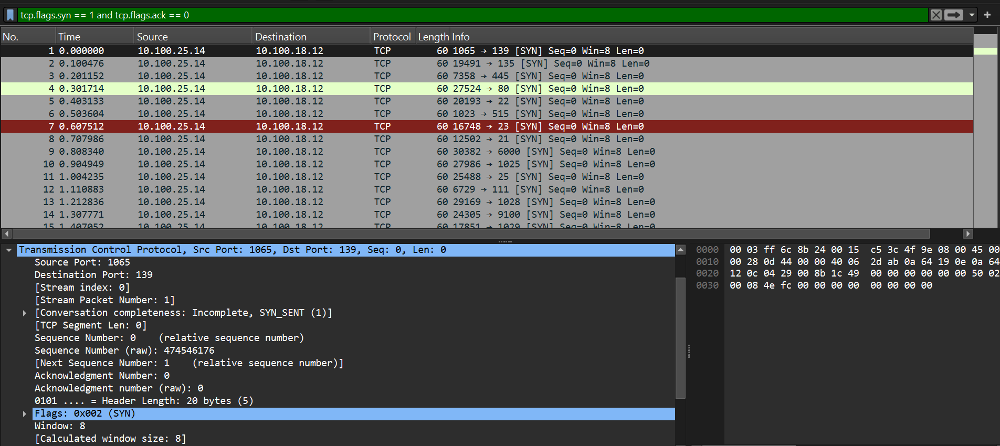
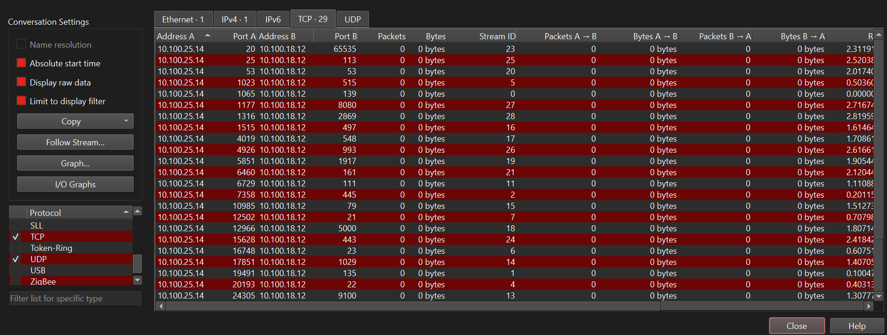
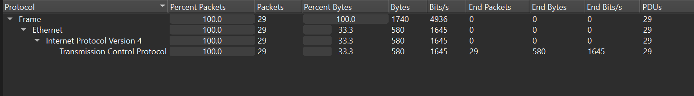
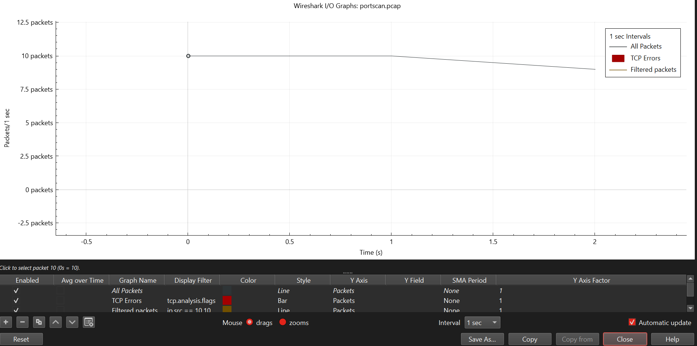

# Lab 03: Network Intrusion & Port Scan Detection

## 📋 Lab Overview
- **Objective:** Detect and analyze network reconnaissance activity by inspecting TCP flags, isolating stealth SYN port scans, profiling targeted services, and visualizing scan pacing via I/O graphs.
- **Attack Technique:** TCP SYN Stealth Port Scan (MITRE ATT&CK T1046 - Network Service Discovery)
- **Analyzed Capture File:** `portscan.pcap`
- **Tools Used:** Wireshark v4.x
- **Investigation Role:** Tier-1 SOC Analyst / Intrusion Analyst
- **Status:** Completed

---

## 🔍 Key Wireshark Display Filters

| Display Filter | Purpose & Description |
|---|---|
| `tcp.flags.syn == 1 and tcp.flags.ack == 0` | Isolates initial TCP connection requests (`SYN` only) to detect port scanning |
| `tcp.flags.reset == 1` | Checks for `RST` packets returned by closed ports (absent when packets are silently dropped) |
| `ip.src == 10.100.18.12` | Filters any response traffic originating from the targeted victim host |

---

## 🧪 Forensic Walkthrough & Evidence

### Step 1: Detecting TCP SYN Reconnaissance

**Description:**
Applied the `tcp.flags.syn == 1 and tcp.flags.ack == 0` display filter to isolate half-open connection attempts. The capture shows a single source host (`10.100.25.14`) rapidly probing sequential and well-known destination ports on `10.100.18.12` at a consistent interval of ~0.1 seconds per probe. Inspection of Frame 1 confirms the TCP `Flags: 0x002 (SYN)` bit is set with no accompanying acknowledgment.

**Wireshark Display Filter:**
```wireshark
tcp.flags.syn == 1 and tcp.flags.ack == 0
```


**Observed Details:**
- **Scanner / Attacker IP:** `10.100.25.14`
- **Target / Victim IP:** `10.100.18.12`
- **TCP Flags (Frame 1):** `0x002 (SYN)`, `Seq=0`, `Win=8`, `Len=0`
- **Sample Probed Ports:** `139`, `135`, `445`, `80`, `22`, `515`, `23`, `21`, `6000`, `1025`, `25`, `111`

---

### Step 2: Profiling Scanned Ports via TCP Conversations

**Description:**
Opened `Statistics > Conversations` (TCP tab) to enumerate all targeted destination ports and inspect bidirectional packet counts. A total of 29 distinct TCP streams were recorded from `10.100.25.14` to `10.100.18.12`. Checking `tcp.flags.reset == 1` and `ip.src == 10.100.18.12` confirmed zero response packets from the victim, indicating either a host-based/perimeter firewall silently dropping probes or a unidirectional capture.

**Wireshark Tool:**
`Statistics > Conversations (TCP)`

**Evidence / Screenshot:**
<!-- Place your captured screenshot in the screenshots/ directory and link it below -->


**Observed Details:**
- **Total TCP Conversations:** 29 unique port probes
- **High-Risk Targeted Ports:** `21` (FTP), `22` (SSH), `23` (Telnet), `53` (DNS), `135/139/445` (SMB/RPC), `443` (HTTPS), `8080` (HTTP-Alt), `9100` (Printer/JetDirect)
- **Victim Response Behavior:** 0 `RST` or `SYN/ACK` packets observed

---

### Step 3: Protocol Hierarchy & Payload Verification

**Description:**
Inspected `Statistics > Protocol Hierarchy` to verify whether the scan included higher-layer application payloads or additional transport protocols (such as UDP or ICMP). Results confirm that 100% of the 29 captured frames (1,740 total bytes; 4,936 bits/s) consist solely of Ethernet, IPv4, and raw TCP headers with zero application-layer data.

**Wireshark Tool:**
`Statistics > Protocol Hierarchy`

---

**Evidence / Screenshot:**
<!-- Place your captured screenshot in the screenshots/ directory and link it below -->


**Observed Details:**
- **Total Packets:** 29 frames (100% IPv4 / TCP)
- **Total Traffic Volume:** 1,740 bytes (Average: 4,936 bits/s)
- **Application Payloads:** None (`End Packets: 29` at TCP layer), confirming pure Layer-4 port enumeration

---

### Step 4: Visualizing Scan Rate via I/O Graphs

**Description:**
Generated a traffic rate timeline using `Statistics > I/O Graphs` at 1-second intervals. The graph demonstrates a steady, automated scanning cadence of **10 packets per second** across the first two seconds, tapering to 9 packets in the final second (29 packets total over ~2.8 seconds). This uniform rate is characteristic of a scripted or throttled port scanner (e.g., Nmap timing template).

**Wireshark Tool:**
`Statistics > I/O Graphs`

**Evidence / Screenshot:**
<!-- Place your captured screenshot in the screenshots/ directory and link it below -->


**Observed Details:**
- **Scan Cadence:** Steady ~10 packets/sec (1 SYN probe every ~0.10 seconds)
- **Capture Duration:** ~2.82 seconds
- **Traffic Pattern:** Automated, uniform bursts with zero legitimate user session variance

---

## 📊 Summary of Findings & Intrusion Indicators

| Attribute | Recorded Value | Security Context |
|---|---|---|
| **Investigated Capture File** | `portscan.pcap` | Network reconnaissance capture |
| **Scanner / Source IP** | `10.100.25.14` | Unauthorized scanning host |
| **Target / Victim IP** | `10.100.18.12` | Scanned internal server/workstation |
| **Scan Type Identified** | TCP SYN Stealth Scan | Half-open probes (`Flags: 0x002`) |
| **Total Ports Probed** | 29 ports | Includes SMB, SSH, Telnet, FTP, HTTP/HTTPS |
| **Scan Rate** | ~10 packets/sec | Automated 0.1s probe interval |

---


## 🛡️ Security Implications & SOC Defense

1. **Early Threat Detection (IDS/IPS Rules):** Configure Snort/Suricata or firewall thresholds to alert on high counts of `SYN` packets without `ACK` from a single source IP within a short time window.
2. **Minimize Attack Surface:** Disable unused legacy services targeted in this scan (especially Telnet port `23`, FTP port `21`, and exposed SMB ports `135/139/445`).
3. **Firewall Hardening:** Maintain silent drop rules (`DROP` rather than `REJECT`) on perimeter firewalls to deny attackers port-state feedback during reconnaissance.
4. **Source Investigation:** Audit internal host `10.100.25.14` for unauthorized scanning tools (e.g., Nmap, Masscan) or potential lateral movement from an already compromised asset.

---

## 🔗 References & Learning Material
- Wireshark User Guide: [wireshark.org/docs/dfref](https://www.wireshark.org/docs/dfref/)
- Reference Lab: [0xrajneesh/Wireshark-Projects-for-beginners](https://github.com/0xrajneesh/Wireshark-Projects-for-beginners)
- Capture Source: [Practical Packet Analysis Sample Captures](https://github.com/markofu/pcaps)
- MITRE ATT&CK T1046: [Network Service Discovery](https://attack.mitre.org/techniques/T1046/)